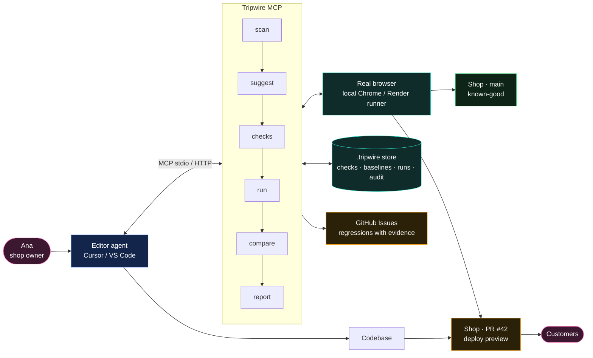
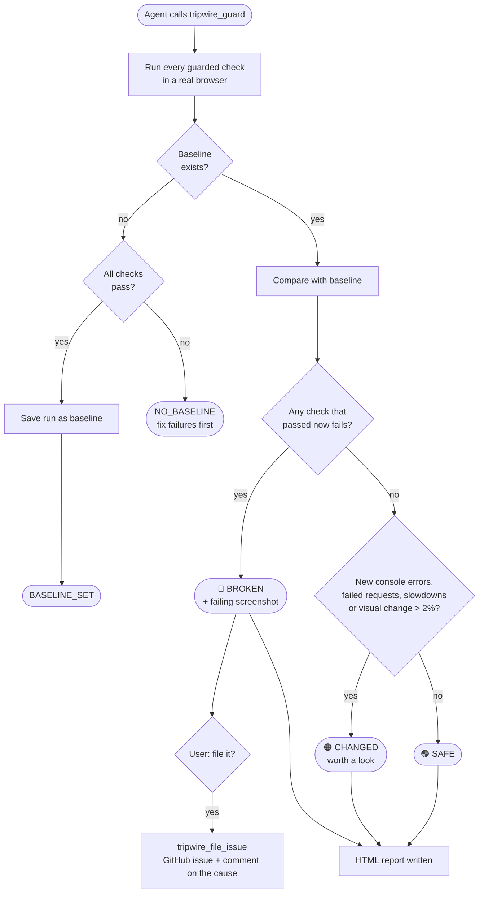
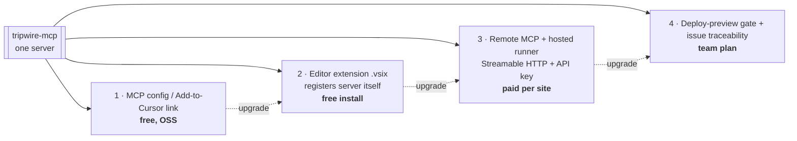
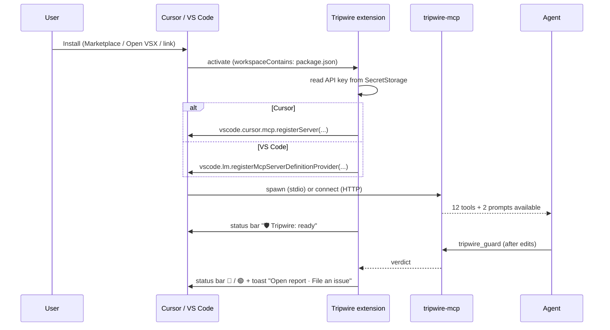
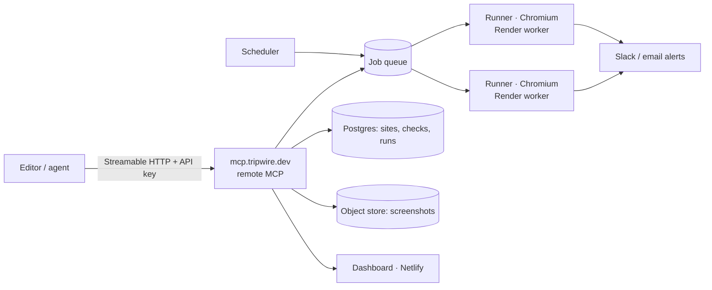

# Tripwire: what it solves, how it works, how it plugs in

> **Describe what must keep working. Tripwire checks it after every change.**

---

## 1. The problem, in real life

Ana runs a small online coffee shop she built with an AI code editor. She has **no tests**, like most people who ship fast.

One afternoon she asks the editor agent to *"tidy up price.ts, it's messy."* The refactor reads cleanly, the page loads, there are no errors, so she deploys. But one division is now applied twice:

```diff
- Math.round(sum * (1 - pct / 100) * 100) / 100
+ Math.round(sum * (1 - pct / 100 / 100) * 100) / 100
```

The site still says **"10% off applied"**, but the total barely moves: **€14.49 instead of €13.05**. No crash, nothing in the logs. Days later a customer emails: *"Your discount code doesn't work??"*

| | Without Tripwire | With Tripwire |
|---|---|---|
| When the bug is found | Days later | **Before the commit** |
| Who finds it | A customer | **Tripwire** |
| Customers affected | Every new buyer | **0** |
| Tests Ana wrote | 0, which was the problem | **0. She described the rules in words** |

*An example scenario. The bug itself is real and reproducible with `demo/serve.mjs`.*

### Why existing options miss Ana
- **Writing tests** requires skills and time she doesn't have, and it's the step people who ship fast skip.
- **QA platforms** are built for QA engineers, live outside the editor and need setup.
- **Clicking around manually** misses anything that doesn't look broken: wrong totals, a silent form failure, a link that 404s on one page.

---

## 2. What Tripwire does

An **MCP server** that gives the coding agent in your editor a regression guard. It is built for Cursor and is a standard MCP server, so other editors that speak MCP should work too:

1. **Scan**: open the real site and map pages, forms, buttons and selectors.
2. **Suggest**: rank what a non-tester cares about (cart, checkout, login, forms, navigation).
3. **Guard**: the user says a rule in plain English and the agent turns it into browser steps. The user's words are stored as the spec.
4. **Run**: check it in a real browser and keep the evidence: screenshots, console errors, failed requests, timing.
5. **Compare**: diff against the known-good baseline: newly failing, new errors, new 4xx/5xx, slower, visually changed.
6. **Verdict**: **SAFE / CHANGED / BROKEN**, in one plain sentence plus a screenshot and an HTML report.
7. **Close the loop**: file a GitHub issue with the promise, what is at stake and the steps to reproduce in plain words, and comment on the issue whose change caused it.

**Design principle:** the agent in the editor is the brain (it understands intent and writes steps). Tripwire is the hands (a real browser) and the memory (baselines, history, audit trail). No second LLM, no extra API key.

---

## 3. Control flow

### 3.1 Components



### 3.2 The decision logic of `tripwire_guard`



### 3.3 The full story as a sequence (setup, change, catch, fix)

```mermaid
sequenceDiagram
    autonumber
    actor Ana
    participant Agent as Editor agent
    participant TW as Tripwire MCP
    participant Br as Browser
    participant Main as Shop · main
    participant PR as Shop · PR #42
    participant St as .tripwire store
    participant GH as GitHub Issues

    rect rgb(20,30,50)
    note over Ana,GH: One-time setup (≈ 2 minutes, zero test code)
    Ana->>Agent: /guard_my_app http://localhost:4321
    Agent->>TW: tripwire_scan_site(url)
    TW->>Br: crawl (Firecrawl map if key set)
    Br->>Main: visit pages
    Main-->>TW: 4 pages · 3 forms · 9 buttons + selectors
    Agent->>TW: tripwire_suggest_checks
    TW-->>Agent: cart · checkout · contact · navigation
    Agent-->>Ana: "What else must never break?"
    Ana->>Agent: "Yirgacheffe + WELCOME10 = €13.05"
    Agent->>TW: tripwire_add_check(steps, priority: critical)
    TW->>St: checks.json
    Agent->>TW: tripwire_guard()
    TW->>Br: run 5 checks on main
    Br-->>TW: all pass + screenshots
    TW->>St: baseline = run_1
    TW-->>Agent: BASELINE_SET
    end

    rect rgb(45,20,20)
    note over Ana,GH: Weeks later: the risky change
    Ana->>Agent: "Refactor price.ts, it's messy"
    Agent->>PR: edit code → deploy preview
    Agent->>TW: tripwire_guard(targetUrl: preview, change: issue #1)  [rule: guard before commit]
    TW->>Br: run 5 checks on PR
    Br->>PR: discount flow
    PR-->>Br: total = €14.49 ✗
    TW->>St: load baseline run_1
    TW->>TW: compare → newly_failing (critical)
    TW-->>Agent: 🔴 BROKEN + screenshot + report.html
    Agent-->>Ana: "Discount broke: €13.05 → €14.49. Fix and log it?"
    end

    rect rgb(15,40,25)
    note over Ana,GH: Close the loop
    Ana->>Agent: "Yes"
    Agent->>TW: tripwire_file_issue()  [the run knows the change was for #1]
    TW->>GH: new issue with repro steps, comment on #1
    Agent->>PR: fix price.ts
    Agent->>TW: tripwire_guard()
    TW-->>Agent: 🟢 SAFE · 5/5 · "fixed: discount"
    Agent-->>Ana: Safe to ship
    end
```



### 3.4 A check, as stored

Ana said: *"If I add the Yirgacheffe and use WELCOME10, the total should be €13.05."* The agent saved:

```json
{
  "name": "Discount code WELCOME10 takes 10% off",
  "intent": "If I add the Yirgacheffe and use WELCOME10, the total should be €13.05",
  "stakes": "New customers pay full price and stop trusting the shop.",
  "priority": "critical",
  "steps": [
    { "action": "goto", "path": "/shop" },
    { "action": "click", "selector": "[data-testid=add-0]" },
    { "action": "expectVisible", "text": "Added to cart" },
    { "action": "goto", "path": "/cart" },
    { "action": "fill", "selector": "#code", "value": "WELCOME10" },
    { "action": "click", "selector": "[data-testid=apply]" },
    { "action": "expectText", "selector": "[data-testid=total]", "contains": "€13.05" }
  ]
}
```

And the verdict after the refactor (actual output from `scripts/e2e.mjs`):

```json
{
  "verdict": "BROKEN",
  "headline": "Broken promise: \"If I add the Yirgacheffe and use WELCOME10, the total should be €13.05\". At stake: New customers pay full price and stop trusting the shop.",
  "change": { "label": "refactor price helper", "issue": 12, "files": ["price.js"] },
  "regressions": [{
    "severity": "critical",
    "kind": "newly_failing",
    "name": "Discount code WELCOME10 takes 10% off",
    "detail": "Used to pass, now fails at step 7 (expectText): Expected \"[data-testid=total]\" to contain \"€13.05\" but it showed \"€14.49\"."
  }]
}
```

### 3.5 Tool map

| Phase | Tool | Reads | Writes |
|---|---|---|---|
| Scan | `tripwire_scan_site` | site (browser, Firecrawl) | `sites/<id>/site.json` |
| Suggest | `tripwire_suggest_checks` | site.json | — |
| Guard | `tripwire_add_check`, `tripwire_remove_check`, `tripwire_list_checks` | checks.json | checks.json |
| Run | `tripwire_run` | checks, site | `runs/<id>/run.json`, screenshots |
| Baseline | `tripwire_set_baseline` | run | baseline.json |
| Compare | `tripwire_compare` | run + baseline | diff images, report.html |
| All-in-one | **`tripwire_guard`** | all of the above | all of the above |
| Issues | `tripwire_read_issue`, `tripwire_file_issue` | GitHub Issues | GitHub Issues |
| Trail | `tripwire_history` | runs, audit.jsonl | — |

Every call is appended to `.tripwire/audit.jsonl`: who asked for what, when, and the outcome.

---

## 4. Plugging it in as an extension

One MCP core, four ways in. Each one feeds the next.



### 4.1 Level 1: plain MCP (works today)

`.cursor/mcp.json` (project) or `~/.cursor/mcp.json` (global):

```json
{ "mcpServers": { "tripwire": { "command": "node", "args": ["/absolute/path/to/tripwire-mcp/dist/index.js"] } } }
```

Add a project rule so the agent guards on its own:

```md
<!-- .cursor/rules/tripwire.mdc -->
After any change that affects the UI, call tripwire_guard before committing.
If the verdict is BROKEN, show the screenshot and offer to fix it and file an issue.
Never edit a check to make it pass.
```

### 4.2 Level 2: editor extension

**Activation flow**



**`extension.ts` (core)**

```ts
import * as vscode from "vscode";

export async function activate(ctx: vscode.ExtensionContext) {
  const key = (await ctx.secrets.get("tripwire.apiKey")) ?? "";
  const env = { TRIPWIRE_API_KEY: key, TRIPWIRE_HOME: ".tripwire" };   // empty key = free local mode
  const serverPath = ctx.asAbsolutePath("server/index.js");            // the server ships inside the extension

  const cursorMcp = (vscode as any).cursor?.mcp;
  if (cursorMcp) {
    cursorMcp.registerServer({ name: "tripwire", server: { command: "node", args: [serverPath], env } });
  } else {
    ctx.subscriptions.push(
      vscode.lm.registerMcpServerDefinitionProvider("tripwire", {
        provideMcpServerDefinitions: () => [
          new vscode.McpStdioServerDefinition("Tripwire", "node", [serverPath], env),
        ],
      }),
    );
  }

  const bar = vscode.window.createStatusBarItem(vscode.StatusBarAlignment.Left);
  bar.text = "$(shield) Tripwire: ready";
  bar.command = "tripwire.openLastReport";
  bar.show();
  ctx.subscriptions.push(bar);

  // Watch .tripwire/ for new runs → update the status bar and toast on BROKEN
  const watcher = vscode.workspace.createFileSystemWatcher("**/.tripwire/sites/*/runs/*/run.json");
  watcher.onDidCreate(async (uri) => {
    const run = JSON.parse((await vscode.workspace.fs.readFile(uri)).toString());
    const failed = run.summary.failed;
    bar.text = failed ? `$(alert) Tripwire: ${failed} failing` : "$(pass) Tripwire: SAFE";
    if (failed) vscode.window.showWarningMessage(`Tripwire: ${failed} guarded check(s) failing`, "Open report");
  });
  ctx.subscriptions.push(watcher);
}
```

**`package.json` (extension manifest, key parts)**

```json
{
  "name": "tripwire",
  "displayName": "Tripwire: did I break anything?",
  "engines": { "vscode": "^1.101.0" },
  "activationEvents": ["workspaceContains:package.json"],
  "contributes": {
    "mcpServerDefinitionProviders": [{ "id": "tripwire", "label": "Tripwire" }],
    "commands": [
      { "command": "tripwire.setApiKey", "title": "Tripwire: Set API key" },
      { "command": "tripwire.openLastReport", "title": "Tripwire: Open last report" }
    ]
  }
}
```

**What the extension adds beyond the MCP server**
- No JSON to edit: it registers itself.
- A status-bar verdict and a toast: the verdict is visible even when the chat is closed.
- API keys kept in the editor's secret storage, not in `mcp.json`.
- Guard on save or before commit (command + git hook).
- Report viewer in a webview panel.

### 4.3 Level 3: remote MCP + hosted runner (the paid product)



- The local server already supports `TRIPWIRE_BROWSER_WS`, so pointing it at a remote browser is one environment variable.
- Paid features: scheduled monitoring while the laptop is closed, alerts, shareable dashboards and history, many sites (agencies).

### 4.4 Level 4: deploy gate + issue traceability (team)

- A Netlify or Vercel deploy-preview webhook triggers `guard(targetUrl: preview)`, and the result is posted as a PR comment and check.
- `verify_issue(42)` turns an issue's acceptance criteria into checks. Regressions are filed and linked back to the issue that caused them.
- The audit trail records every call: who asked for what, when, and what happened.

### 4.5 Distribution and selling

| Channel | Ships | Effort |
|---|---|---|
| Website + Add-to-Cursor button | prebuilt package on a GitHub release | minutes |
| cursor.directory, Smithery, PulseMCP, official MCP registry | listing → the release | ~1 hour |
| VS Code Marketplace + Open VSX | `.vsix` (Cursor installs from Open VSX) | ~1 day |
| Cursor Marketplace | plugin: MCP server + guard rule | ~1 day |
| Paid MCP marketplaces | hosted endpoint, platform handles billing | optional |

**Model: open core.** The local MCP server and the extension are free; they're the funnel. Customers pay for what runs when they aren't at the keyboard: hosted runners, schedules, alerts, history, team gates.

| Plan | Who | What |
|---|---|---|
| Free | Vibe-coders, students | Local runs, one site, HTML reports |
| Pro (per site / month) | Indie founders, small shops | Hosted runner, scheduled checks, alerts, dashboard |
| Agency | Agencies | Many sites, client-ready reports |
| Team (per seat / month) | Dev and QA teams | Deploy-preview gate, issue traceability, audit trail, SSO |

---

## 5. Roadmap

- [x] MCP server: scan, suggest, guard, run, compare, report, GitHub Issues, audit
- [x] Demo shop with a planted regression + end-to-end script
- [ ] Editor extension (status bar, secrets, guard-on-save)
- [ ] Hosted runner on Render + dashboard on Netlify
- [ ] Deploy-preview gate (PR comments)
- [ ] Behavioural-diff mode for APIs (replay traffic against base vs PR)
- [ ] Extras: accessibility, broken links, mobile viewport, stored login sessions

---

## 6. Run the demo

```bash
npm install && npm run build
node demo/serve.mjs                       # good build      → http://localhost:4321
BROKEN=1 PORT=4322 node demo/serve.mjs    # broken refactor → http://localhost:4322
node scripts/e2e.mjs                      # scan → guard (baseline) → guard (PR) → BROKEN
```
